# Charybdis Mini

|  |  |
|---|---|
| **MCU / board** | 2× [nice!nano v2](https://nicekeyboards.com/nice-nano/) (nRF52840) — ZMK board `nice_nano_v2` + shield `charybdis_{left,right}` |
| **Layout** | 34 keys · column-staggered **split** with thumb cluster (left = BLE central) |
| **Switches** | MX · hot-swap sockets |
| **Designer** | [Bastard Keyboards](https://bastardkb.com) |
| **Hardware / docs** | [Charybdis](https://bastardkb.com/charybdis/) |
| **Features** | BLE · USB · deep sleep · battery reporting |

34-key column-staggered **split** keyboard with integrated trackball. Each half is a
[nice!nano v2](https://nicekeyboards.com/nice-nano/); ZMK builds it as
board `nice_nano_v2` + shield `charybdis_left` / `charybdis_right`,
with the **left** half as the BLE central.

## Keymap



## Build & flash

From the repo root:

```sh
nix build .#charybdis-mini            # -> result/{zmk_left,zmk_right}.uf2
nix run  .#flash-charybdis-mini       # prompts for left, then right
nix run  .#flash-charybdis-mini-reset # wipe BLE/settings if pairing breaks
```

Config lives in [`config/`](./config). The diagram is generated with
[keymap-drawer](https://github.com/caksoylar/keymap-drawer) from
`config/charybdis.keymap` + the `config/charybdis.json` physical layout —
regenerate it with `nix run .#draw-keymaps` from the repo root.
