# Dao

|  |  |
|---|---|
| **MCU / board** | custom nRF52840 (QIAA) — ZMK boards `dao_{left,right}`, no shield |
| **Layout** | 42 keys · column-staggered **split** (left = BLE central) |
| **Switches** | Kailh Choc v1 (PG1350) · hot-swap sockets |
| **Designer** | [Rafael Yumagulov](https://github.com/yumagulovrn) · keymap by antono |
| **Hardware / PCB** | [yumagulovrn/dao-choc-ble](https://github.com/yumagulovrn/dao-choc-ble) · [kbd.news](https://kbd.news/Dao-Choc-BLE-1146.html) |
| **Features** | BLE · USB · deep sleep · battery · ZMK Studio · Corne/full physical layouts |

42-key column-staggered **split** keyboard. Each half is its own custom
nRF52840 board — ZMK builds `dao_left` and `dao_right` directly (no shield),
with the **left** half as the BLE central. Hardware and base config by
[Rafael Yumagulov](https://github.com/yumagulovrn); this is antono's keymap
(the [`antono-layout`](https://github.com/antono/dao-zmk-config/tree/antono-layout)
branch). The default keymap selects the **Corne** physical layout and supports
[ZMK Studio](https://zmk.dev/docs/features/studio).

## Keymap



## Build & flash

From the repo root:

```sh
nix build .#dao              # -> result/{zmk_left,zmk_right}.uf2
nix run  .#flash-dao         # prompts for left, then right

nix build .#dao-studio       # same, with ZMK Studio enabled on the left (central)
nix run  .#flash-dao-studio

nix run  .#flash-dao-reset   # settings reset (built on nice_nano_v2)
```

`dao-studio` enables ZMK Studio (the `studio-rpc-usb-uart` snippet +
`CONFIG_ZMK_STUDIO=y`) on the central/left half; the right peripheral is built
plain, since Studio talks to the keyboard over the central. Flash `zmk_left.uf2`
from `dao-studio` to use Studio.

Config lives in [`config/`](./config), with the board definitions under
`config/boards/arm/dao/` (vendored from
[ergonautkb/ergonautkb-zmk-module](https://github.com/ergonautkb/ergonautkb-zmk-module)
so the config is self-contained). The diagram is generated with
[keymap-drawer](https://github.com/caksoylar/keymap-drawer) from
`config/dao.keymap` + the `config/info.json` physical layout — regenerate it
with `nix run .#draw-keymaps` from the repo root.
