# Ergonaut One

|  |  |
|---|---|
| **MCU / board** | 2× [Seeeduino XIAO BLE](https://wiki.seeedstudio.com/XIAO_BLE/) (nRF52840) — ZMK board `seeeduino_xiao_ble` + shield `ergonaut_one_{left,right}` |
| **Layout** | 42 keys · column-staggered **split** (left = BLE central) |
| **Switches** | Gateron Low Profile (KS-33 v2) · hot-swap sockets |
| **Designer** | [Ergonaut Keyboards](https://ergonautkb.com) |
| **Hardware / docs** | [ergonautkb/one](https://github.com/ergonautkb/one) · [docs](https://ergonautkb.com/docs/keyboards/ergonaut-one/intro) |
| **Features** | BLE · USB · deep sleep · battery reporting |

42-key column-staggered **split** keyboard. Each half is a
[Seeeduino XIAO BLE](https://wiki.seeedstudio.com/XIAO_BLE/); ZMK builds it as
board `seeeduino_xiao_ble` + shield `ergonaut_one_left` / `ergonaut_one_right`,
with the **left** half as the BLE central.

## Keymap



## Build & flash

From the repo root:

```sh
nix build .#ergonaut-one            # -> result/{zmk_left,zmk_right}.uf2
nix run  .#flash-ergonaut-one       # prompts for left, then right
nix run  .#flash-ergonaut-one-reset # wipe BLE/settings if pairing breaks
```

Config lives in [`config/`](./config). The diagram above is generated with
[keymap-drawer](https://github.com/caksoylar/keymap-drawer) from
`config/ergonaut_one.keymap` + the `config/ergonaut_one.json` physical layout.
After editing the keymap, regenerate it from the repo root:

```sh
nix run .#draw-keymaps   # re-renders keymap-drawer/ergonaut-one.svg
```
