# Mriya46

46-key column-staggered **split** keyboard. Each half is its own custom
nRF52840 board — ZMK builds `mriya_left` and `mriya_right` directly (no shield),
with the **left** half as the BLE central. Designed by
[Andrei Gaevkii](https://github.com/Ladniy).

## Keymap



## Build & flash

From the repo root:

```sh
nix build .#mriya46            # -> result/{zmk_left,zmk_right}.uf2
nix run  .#flash-mriya46       # prompts for left, then right
nix run  .#flash-mriya46-reset # settings reset (built on nice_nano_v2)
```

Config lives in [`config/`](./config), with the board definitions under
`config/boards/arm/mriya/`. The diagram is generated with
[keymap-drawer](https://github.com/caksoylar/keymap-drawer) from
`config/mriya.keymap` + the `config/mriya.json` physical layout — regenerate it
with `nix run .#draw-keymaps` from the repo root.
