# Ladniy/TK44

44-key unibody keyboard with angled/rotated columns. Single custom **`tk44`**
board built around an nRF52840 (QIAA) — no shield, no split. Designed by
[Ladniy/TK44](https://github.com/Ladniy/TK44).

## Keymap



## Build & flash

From the repo root:

```sh
nix build .#tk44        # -> result/zmk.uf2
nix run  .#flash-tk44
```

Config lives in [`config/`](./config), with the board definition under
`config/boards/arm/tk44/`. The diagram is generated with
[keymap-drawer](https://github.com/caksoylar/keymap-drawer) from
`config/tk44.keymap` + the `config/tk44.json` physical layout — regenerate it
with `nix run .#draw-keymaps` from the repo root.
